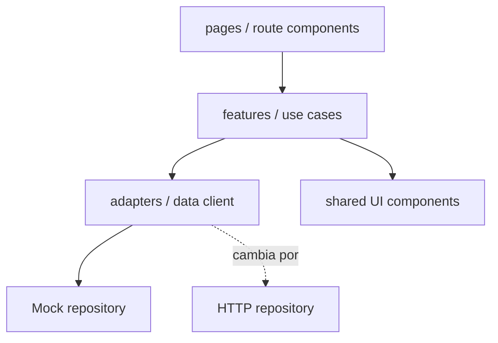

# Guía de arquitectura frontend

**Estado:** frontend-first CONFIRMADO; herramientas y capas RECOMENDADAS. **Revisión:** 2026-11-10.

## Propósito

Transformar la **dirección visual v0.4** aceptada en una aplicación React mantenible que hoy funcione con mocks y mañana pueda consumir API NestJS sin reescribir componentes. La v0.4 no es un build verificado ni una base de código para volcar íntegramente.

## Responsabilidades por capa



- **Pages/Routes:** composición, navegación y estados de pantalla.
- **Features:** lógica de la vista concreta, formularios, filtros, guardas de acciones *para UX*.
- **Entities/Models:** tipos de representación del dominio, no clones automáticos del modelo SQL.
- **Data adapters:** contrato abstracto en la frontera HTTP/mock, traducción de DTO a modelo de la UI.
- **UI shared:** primitives shadcn y componentes compartidos sin reglas de autorización global.
- **Fixtures:** dos organizaciones, datos coherentes y relaciones válidas; nunca una falsa capa de seguridad.

## Estructura de referencia, crear gradualmente

```text
apps/web/
  src/
    app/                # composición, providers y rutas
    features/
      incidents/        # lista, filtros, detalle y formulario
      dashboard/        # resumen operativo
      assets/           # cuando exista el primer flujo de activos
      work-orders/      # Sprint 2
    components/ui/      # primitives instaladas mediante shadcn
    components/layout/  # AppShell, Sidebar, Topbar
    lib/                # utilidades pequeñas y configuración
    services/           # adaptadores mock / HTTP por frontera
    test/               # fixtures y utilidades de test compartidas
```

No es obligatorio crear todos los directorios antes de tener código. Evitar una jerarquía de 6 niveles para un componente pequeño.

## Primer adaptador HTTP: lectura real, sin login simulado (2026-11-11)

- Se añadió `apps/web/src/features/api-read/api-client.ts`, adaptador
  de solo lectura a rutas NestJS para perfil, organizaciones autorizadas,
  activos y paginación/detalle de incidencias.
- `?source=api` activa una vista separada **solo en desarrollo**. El
  dashboard normal continúa trabajando exclusivamente con fixtures.
- Las solicitudes son `GET` same-origin `/api`, con cookie nativa,
  enviadas por el proxy Vite hacia el Nest local en loopback.
  No se guardan JWT, IDs de usuario, credenciales ni tokens en el frontend.
- `401`, `403` y respuestas inválidas son errores visibles; nunca
  se hace fallback automático a fixtures. Antes de una sesión válida
  no se consultan ni muestran organizaciones del servidor.
- El selector solo lista empresas autorizadas por `GET /me/organizations`;
  cambiar de empresa remonta la vista y cancela peticiones anteriores.
  La API revalida la membresía ACTIVE en cada llamada.
- **El resultado de una página no es el total global de incidencias**;
  la UI no inventa prioridad, responsable ni ubicación si la API no
  proporciona esos campos.
- El detalle exige otra petición autenticada. No se ha habilitado
  mutación. Google OIDC se puede iniciar mediante un enlace de
  desarrollo al proxy `/auth/oidc` **solo** cuando NestJS publica
  `google` en `/auth/oidc/providers`; eso no supone que haya un
  login real comprobado. La conexión completa depende de validar
  callback y cookie `Secure` en navegador, y del despliegue HTTPS.
- Pruebas React del adaptador, cambios de tenant, paginación y errores;
  Playwright valida el `401` real local y respuestas interceptadas en CI.

## Diseño de datos en frontend

- Representar identificadores como valores opacos; no deducir organización a partir del formato de ID.
- No guardar tokens ni datos sensibles en mocks persistentes.
- Una `IncidentView` puede contener información lista para presentar (activo, responsable, estado), aunque la API use otras representaciones.
- Separar **estado del servidor** (requests/cache), **estado de formulario** (campos/errores) y **estado de interfaz** (drawer, filtros).
- Cuando haya servidor, evaluar TanStack Query para caché/invalidez y un router explícito. No añadirlo hasta que resuelva un problema.
- Al cambiar de empresa: limpiar selección, resetear detalle, filtros contextuales y cachés asociadas a empresa; en backend vuelve a comprobarse autorización.

## Componentes y reglas

- shadcn/ui como **código local**, sin alterar su base visual arbitrariamente por pantalla.
- Tokens semánticos para light/dark y estado; no hardcodear estilos en cada tabla.
- Componentes de negocio (`IncidentStatusBadge`) traducen valores semánticos a componentes visuales.
- Formularios validan campos y mensajes, pero **el backend revalida todo**.
- La lógica de permisos en botones solo mejora UX; nunca es la barrera de seguridad.
- Evitar componentes universales gigantes con docenas de props; extraer cuando exista duplicación real.
- Mantener cabeceras de tablas, celdas de datos y acciones navegables por teclado.

## Páginas iniciales y alcance

### Dashboard

Una pantalla de **lectura** con datos computados de fixtures, no estadísticas inventadas. Definir con claridad denominador/periodo de cada KPI, estado vacío y comportamiento al cambiar empresa.

### Incidencias

Pantalla **prioritaria**: búsqueda y filtros, tabla/esquema responsive, panel de detalle, creación de incidencia. La creación constituye el primer flujo vertical. En el mock no simular “la seguridad existe”: marcar los roles como datos demo.

## Estados que deben existir para cada operación

| Estado | Comportamiento |
| --- | --- |
| Initial/loading | Skeleton o indicador no intrusivo |
| Empty | Mensaje preciso y acción contextual |
| Success | Notificación no bloqueante y actualización consistente |
| Validation error | Error asociado al campo con explicación |
| Forbidden | Información útil sin filtrar datos privados |
| Network/server error | Reintentar sin perder formulario |
| Stale data | Refrescar o evitar decisiones sobre datos obsoletos |

## Pruebas frontend mínimas

- Formulario de incidencia válido e inválido.
- Filtros, ordenación y búsqueda sobre fixtures.
- Cambio de organización actualiza listados/contador y descarta selección.
- Drawer/dialog accesible con teclado; foco restaurado al cerrarse.
- Datos largos, truncamiento y móvil.
- Test del adaptador mock; al conectar API, tests para traducción de DTO y errores.

## Criterio para cambiar un mock por API

El componente depende de un contrato de datos estable y presenta estados asíncronos; la traducción ocurre en el adaptador, no en componentes visuales. Sólo al introducir backend se define el contrato HTTP de producción y se verifican permisos de verdad.

## No hacer

- Importar directamente el ZIP experimental v0.4 como si tuviese calidad de producción.
- Desarrollar primero 40 componentes antes de integrar una funcionalidad completa.
- Construir un `useEffect` gigante por pantalla con reglas de dominio y llamadas HTTP mezcladas.
- Llenar el Dashboard de gráficos sin significado industrial.
