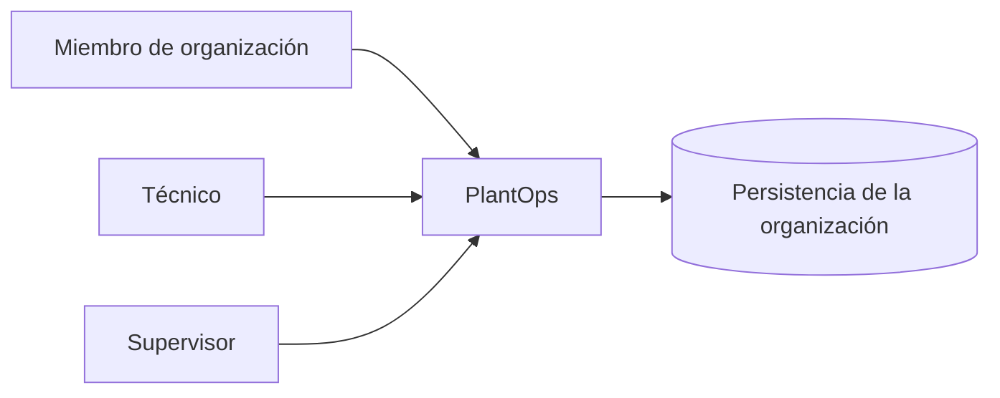
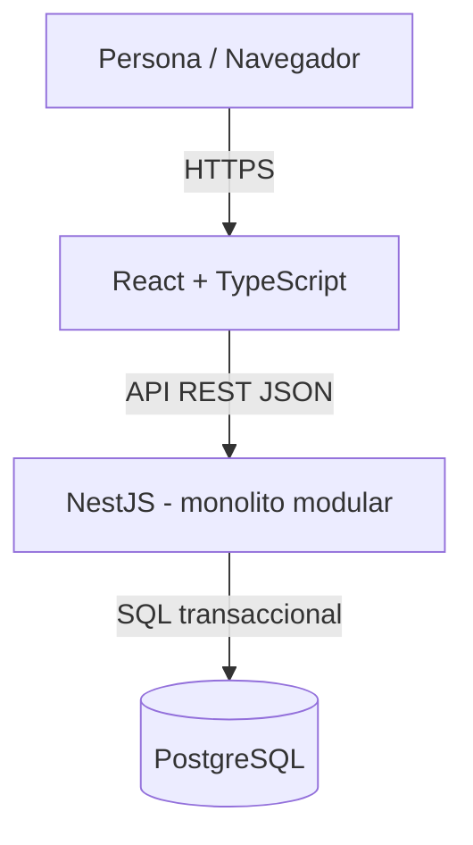
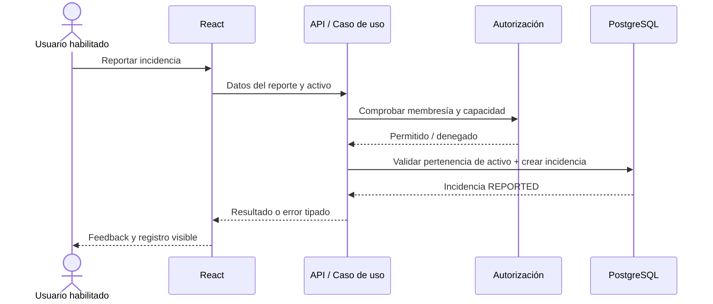

# Arquitectura candidata de PlantOps

**Estado:** PROPUESTA de arquitectura; requiere ADR para multi-tenancy, seguridad y límites. **Revisión:** 2026-11-10.

## Principios de decisión

1. Resolver un **flujo vertical real** antes de introducir todas las capas o módulos.
2. Mantener frontend y backend evolucionables sin convertir el MVP en una plataforma distribuida.
3. Identidad, organización, autorizaciones y consistencia de estados son requisitos transversales.
4. El dominio y sus invariantes son independientes del ORM, la UI y la herramienta de despliegue.
5. No introducir colas, WebSockets ni mensajería hasta demostrar necesidad.

## Contexto — C4 nivel 1 (propuesto)

Este dibujo simplifica el contexto; no implica una base física por organización. PlantOps no integra terceros en el MVP.

## Contenedores — C4 nivel 2 (candidato)

- **Web:** presentación, interacciones y estados de carga/error. No concede autorizaciones reales.
- **API:** validación, autorización contextual, casos de uso, transacciones y auditoría.
- **PostgreSQL:** integridad, persistencia e índices. Estrategia de tenancy pendiente de ADR.
- **Infra:** Compose local y CI recomendados cuando exista código. No desplegar nada por anticipado.

## Límites funcionales sugeridos (no carpetas obligatorias)

| Contexto/módulo | Responsabilidad exclusiva | No debe asumir |
| --- | --- | --- |
| Identity & Membership | Usuario, membresías, sesión y contexto de tenant | Reglas de cierre de órdenes |
| Assets | Inventario y ciclo de vida de activos | Decidir si una incidencia está resuelta |
| Incidents | Reporte, revisión, cierre e invariantes de la incidencia | Cambiar estado interno de cada orden arbitrariamente |
| WorkOrders | Creación, asignación, ejecución, cancelación | Cerrar incidencia sin autorización explícita |
| Audit | Registrar operaciones de negocio relevantes | Sustituir fuente de verdad de estados |

**Nota:** el nombre/agrupación de módulos puede cambiar al estudiar dependencias reales. No crear todos vacíos.

## Flujo de una solicitud de negocio (ejemplo)

## Aislamiento multiempresa (decisión crítica pendiente)

Recomendación inicial: modelo shared database / shared schema con `organization_id` en datos operativos, un contexto de organización autenticado y controles redundantes a nivel consulta e integridad. Esto **no se ha aprobado como ADR definitivo**. Comparar con esquema-por-tenant, BD-por-tenant y posible Row Level Security de PostgreSQL.

Requisitos independientemente de la alternativa:
- Identidad y membresía auténticas, nunca un selector de empresa confiado.
- Todas las lecturas, mutaciones y relaciones respetan límite de organización.
- Pruebas de acceso cruzado y referencias entre tenants.
- No filtrar datos ajenos por mensajes de error ni por logs.
- Migraciones, backups y despliegue viables para un desarrollador.

## Integridad transaccional

El cierre de una incidencia y la creación de una nueva orden asociada son operaciones conflictivas: si corren simultáneamente, no puede terminar una incidencia CLOSED con una orden activa. Necesitamos una transacción y un mecanismo de concurrencia probado (bloqueo/versión/regla de serialización apropiada). **No resolver con un `if` aislado en React**.

## Opciones explícitamente descartadas en el arranque

- Microservicios por módulo, CQRS/event sourcing completo, colas distribuidas y Kubernetes.
- Crear módulos de pagos, analítica avanzada o preventivo antes del flujo correctivo.
- Duplicar tipos entre frontend/backend por conveniencia sin acordar contratos.
- Dependencias circulares y acceso entre módulos a tablas internas como atajo.

## ADR vinculados

- [ADR-0001 — Frontend first](../adr/0001-frontend-first.md) · ACEPTADO como estrategia de entrega.
- [ADR-0002 — Monolito modular](../adr/0002-modular-monolith.md) · PROPUESTO.
- [ADR-0003 — Aislamiento multiempresa](../adr/0003-multi-tenancy.md) · PROPUESTO.

El primer commit de código debería aportar una capacidad observable y una prueba. No una arquitectura vacía.
