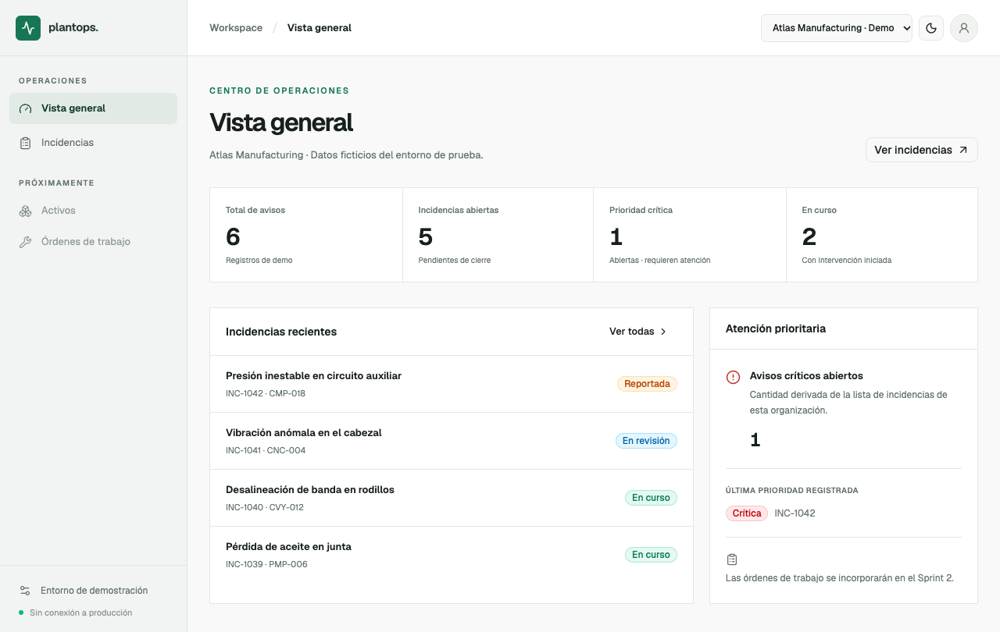
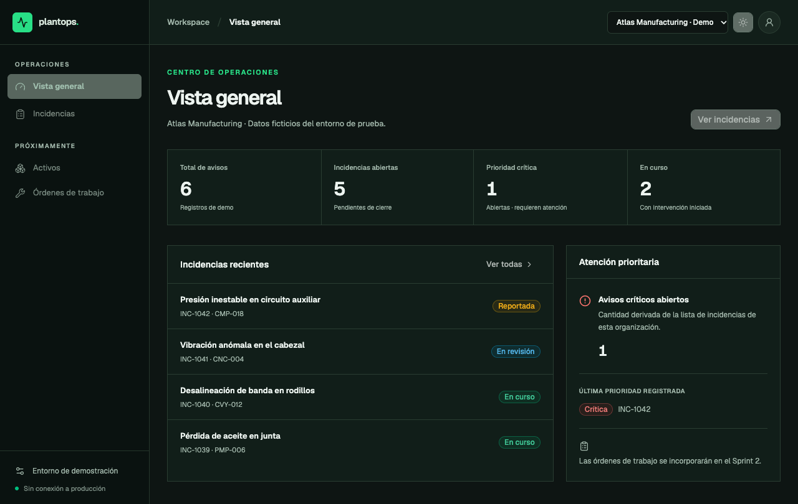
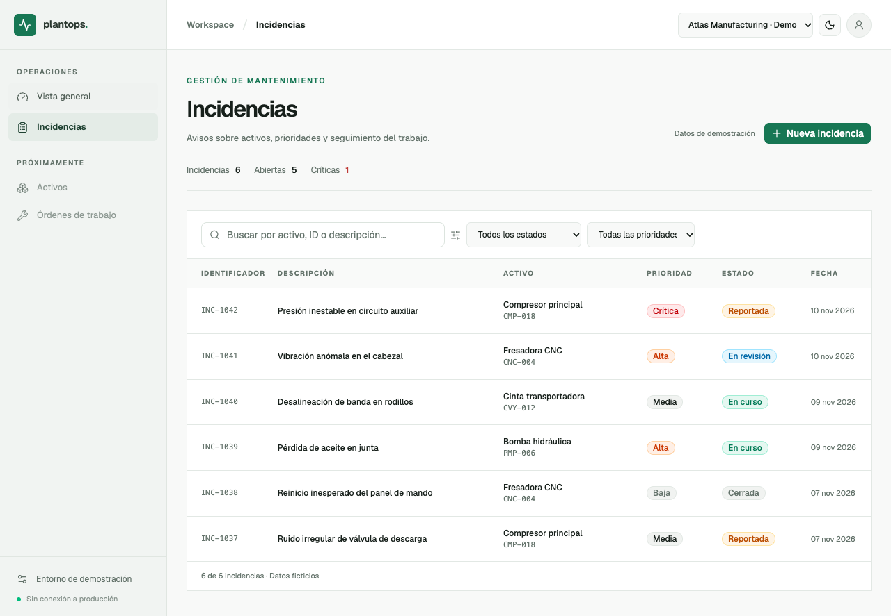
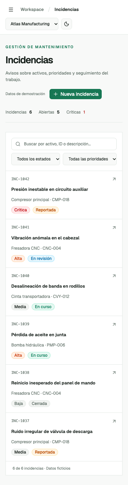

# Capturas verificadas del frontend PlantOps

Capturas **reales** de la aplicación de demostración, tomadas con pruebas de navegador Playwright/Chrome el 10/11/2026. Solo contienen nombres, equipos y registros ficticios.

| Vista | Referencia |
| --- | --- |
| Dashboard · modo claro |  |
| Dashboard · modo oscuro |  |
| Incidencias · escritorio |  |
| Incidencias · móvil (375 px) |  |

Estas imágenes documentan un **corte funcional**, no una aprobación final de todos los detalles de estilo ni una demostración de seguridad de backend. Si cambia significativamente la UI, actualizar las capturas junto con pruebas y PR.
