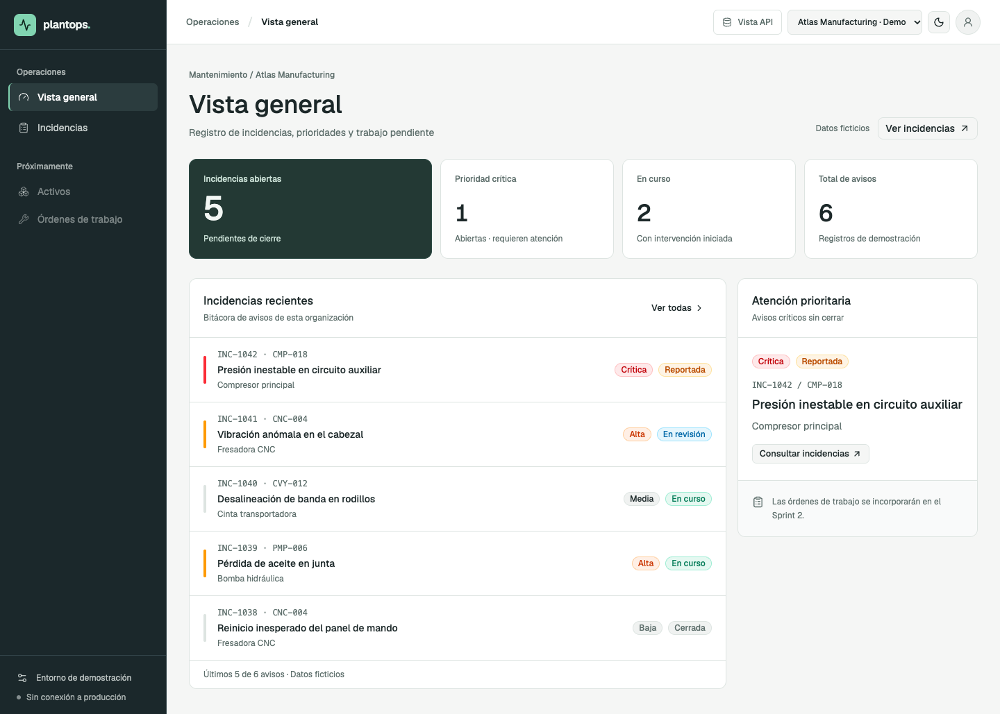
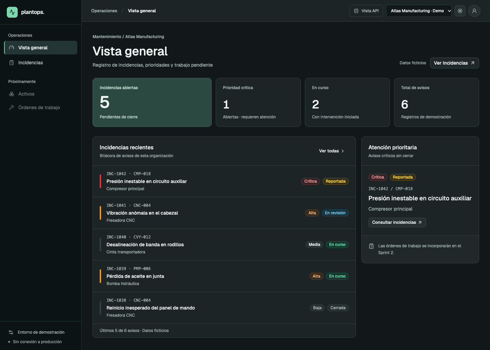
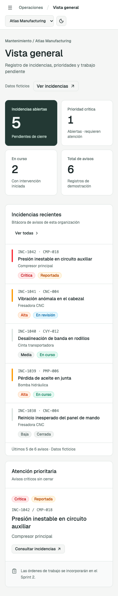
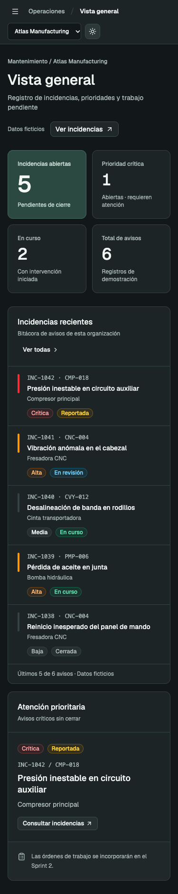
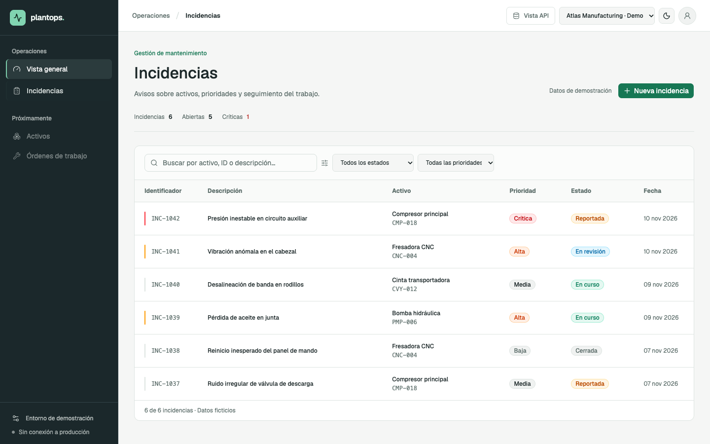
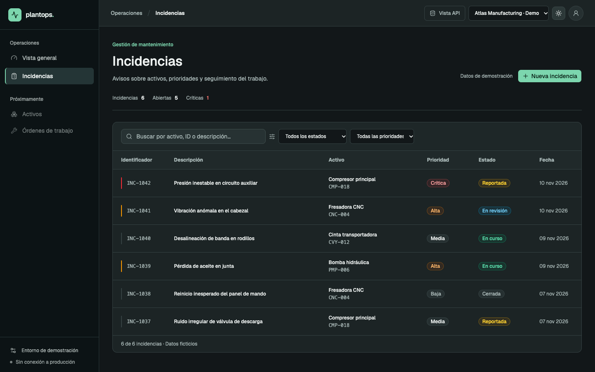
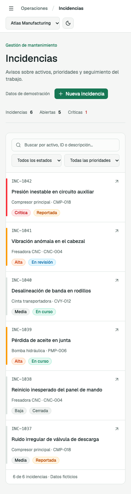
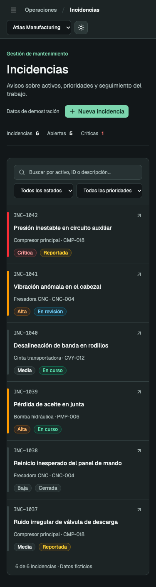

# Capturas verificadas del frontend PlantOps

Capturas **reales** de la aplicación de demostración, tomadas con pruebas de navegador Playwright/Chrome el 10/11/2026. Solo contienen nombres, equipos y registros ficticios.

| Vista | Referencia |
| --- | --- |
| Dashboard · modo claro |  |
| Dashboard · modo oscuro |  |
| Incidencias · escritorio |  |
| Incidencias · móvil (375 px) |  |

Estas imágenes documentan un **corte funcional**, no una aprobación final de todos los detalles de estilo ni una demostración de seguridad de backend. Si cambia significativamente la UI, actualizar las capturas junto con pruebas y PR.

## Pulido Unslop — 11/11/2026

Las capturas anteriores son la referencia **antes** del pulido; las siguientes son el **después**, producido por Chrome/Playwright sobre la misma demo sin API ni datos del piloto. Consultar [la auditoría técnica](../../quality/frontend-unslop-2026-11-11.md).

| Vista posterior | Captura |
| --- | --- |
| Dashboard claro |  |
| Dashboard oscuro |  |
| Incidencias claro |  |
| Incidencias oscuro |  |
| Incidencias móvil a 375 px |  |
| Inspector de incidencia móvil |  |

## Alternativa Unslop v2 — 11/11/2026 (pendiente de aprobación)

[Auditoría y dirección](../../quality/frontend-unslop-direction-v2.md). Capturas generadas desde React/Vite con Chrome, sin datos reales ni acceso a la API. Se conserva la v0.4 y la primera pasada Unslop como referencias; esta versión es una alternativa independiente.

| Vista | Captura real |
| --- | --- |
| Vista general · 1440 px · claro |  |
| Vista general · 1440 px · oscuro |  |
| Vista general · 375 px · claro |  |
| Vista general · 375 px · oscuro |  |
| Incidencias · 1440 px · claro |  |
| Incidencias · 1440 px · oscuro |  |
| Incidencias · 375 px · claro |  |
| Incidencias · 375 px · oscuro |  |
