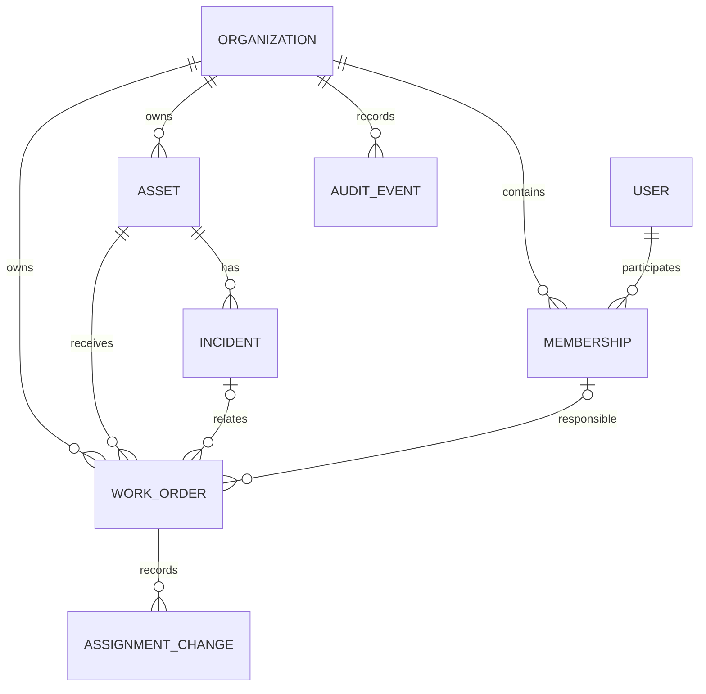
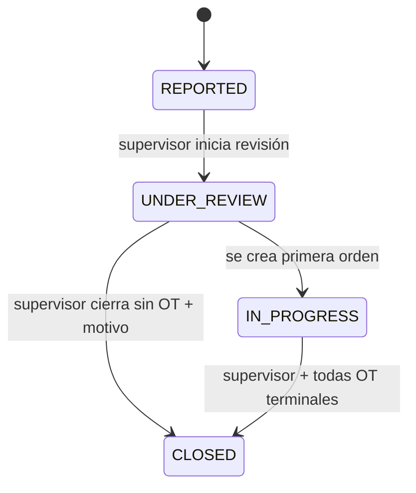
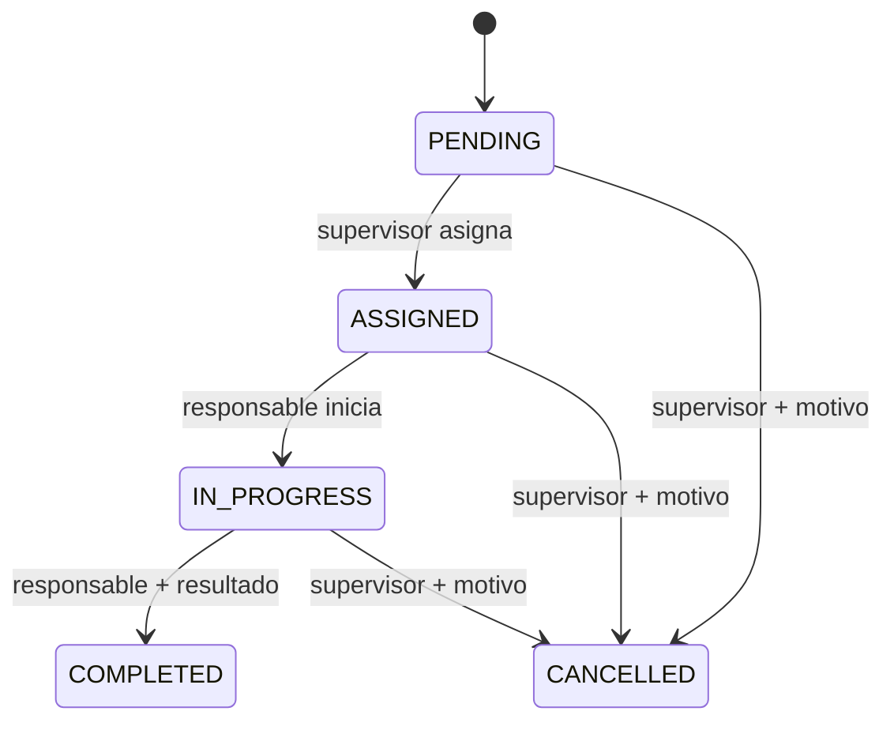

# Modelo de dominio e invariantes

**Estado:** relaciones principales CONFIRMADAS; atributos, implementación y algunas transiciones son RECOMENDADOS. **Revisión:** 2026-11-10.

> Este es un **modelo conceptual**, no un ORM, esquema SQL ni contrato de API aprobado. Los nombres `Incident`, `Asset`, etc. son vocabulario común, no una orden de crear una clase por entidad.

## Mapa de conceptos

**Cardinalidades confirmadas:**
- Cada incidencia pertenece a una organización y **exactamente un activo registrado** de esa organización.
- Una incidencia puede tener **0..N órdenes**.
- Una orden puede enlazar **0..1 incidencia**. La preventiva puede no enlazar ninguna.
- Cada orden tiene **0..1 técnico responsable actual** y puede conservar múltiples asignaciones históricas.
- Toda orden pertenece a una organización y a un activo de esa organización.

**UC-05 resuelve la referencia actual:** el responsable reside en
`work_orders.responsible_membership_id` + `assignment_version`; histórico
inmutable en `work_order_assignments`. Solo `Membership` TECHNICIAN ACTIVE
puede ser el nuevo destino, y el supervisor revalida permiso en transacción.
[Contrato UC-05](../architecture/work-order-assignment-contract.md).
La relación con órdenes preventivas queda pendiente de su corte propio.

## Glosario mínimo

| Concepto | Significado | Observaciones |
| --- | --- | --- |
| Organization | Empresa/tenant dueño del dato | Límite de autorización |
| User | Identidad global | No equivale a pertenecer a una empresa |
| Membership | Relación usuario-organización/roles | Necesaria para asignación segura |
| Asset | Equipo o instalación registrada | No eliminar físicamente si tiene historial |
| Incident | Aviso sobre anomalía de un activo | Su cierre es decisión del supervisor |
| WorkOrder | Intervención concreta sobre un activo | Puede nacer de incidencia correctiva o plan preventivo |
| AssignmentChange | Registro de cambios de responsable | Conserva anterior, nuevo, autor, momento |
| AuditEvent | Huella de acciones relevantes | No sustituye al estado actual |
| MaintenancePlan | Plan de intervenciones periódicas | Futuro, fuera de v0.1 |

## Invariantes (no negociables en el servidor)

**INV-01 — organización:** una acción sólo puede consultar/editar recursos de una organización donde el actor tiene membresía habilitada y autorización. Ignorar `organizationId` recibido del navegador como prueba de acceso.

**INV-02 — activo de la incidencia:** `Incident.asset` existe y pertenece a la misma organización.

**INV-03 — vínculo de orden:** `WorkOrder.organization` = `Asset.organization`; si tiene incidencia, además `Incident.organization` y `Incident.asset` coinciden con los de la orden.

**INV-04 — cardinalidad:** una orden nunca está vinculada a más de una incidencia; una incidencia puede tener varias.

**INV-05 — asignación:** una orden tiene máximo un técnico responsable activo y éste pertenece a la organización. Toda reasignación registra anterior, nuevo, autor y fecha; el motivo es RECOMENDADO.

**INV-06 — ciclo de trabajo:** solo el técnico actualmente responsable inicia/completa su orden, y COMPLETED requiere un resultado documentado. El supervisor asigna/reasigna y cancela con razón.

**INV-07 — cierre de incidencia:** solo el supervisor de la organización cierra una incidencia. Sin órdenes, justificación obligatoria; con órdenes, todas deben estar COMPLETED o CANCELLED (éstas con razón) y el cierre registra conclusión.

**INV-08 — terminalidad:** una incidencia CLOSED no admite nuevas órdenes; COMPLETED/CANCELLED son terminales para una orden durante v0.1; no reabrir objetos terminales en MVP.

**INV-09 — consistencia concurrente:** crear orden y cerrar incidencia no pueden dejar una incidencia cerrada con órdenes activas. El backend deberá garantizarlo dentro de una transacción/estrategia de sincronización documentada y probada.

**INV-10 — trazabilidad:** cambiar estado, asignar/reasignar, cancelar o cerrar genera historial con actor, tiempo, recurso y contexto mínimo. Los eventos deben ser verificables incluso si la UI cambia.

## Estados de incidencia — baseline de producto (revisable)

No transicionar automáticamente a CLOSED cuando una orden termine; el supervisor debe validar la incidencia. Los estados y permisos exactos se fijarán al implementar la primera historia.

## Estados de orden de trabajo — baseline

En el MVP la reasignación ordinaria ocurre **antes** del inicio; cambiar responsable durante IN_PROGRESS queda pendiente de diseño explícito. Si se cancela o completa, no modificar el estado terminal en v0.1.

## Reglas con estado no definitivo

- **PROPUESTA:** distinguir `CORRECTIVE` y `PREVENTIVE` como origen/tipo de orden; correctiva vinculada obligatoriamente a incidencia; preventiva vinculada a activo y sin incidencia.
- **PENDIENTE:** si un supervisor puede desempeñar además funciones de técnico con una segunda membresía/rol y cómo se implementan.
- **PENDIENTE:** si una incidencia puede pasar a revisión directamente antes de que intervenga un supervisor concreto o si requiere asignación.
- **PENDIENTE:** política exacta de desactivación de activos, niveles de severidad y catálogos personalizables.

## Escenarios negativos para diseñar desde el principio

- Usuario de empresa A intenta reportar incidencia sobre activo B → no autorizado, sin revelar información de B.
- Técnico de A intenta completar orden de otro técnico A → denegado.
- Supervisor intenta cerrar incidencia con una orden IN_PROGRESS → conflicto de negocio.
- Supervisor intenta cancelar sin motivo → validación.
- Dos solicitudes simultáneas crean orden y cierran incidencia → una debe fallar o esperar conforme a estrategia atómica.
- Usuario cambia de organización en frontend → nunca habilita recursos de otras empresas por sí solo.
